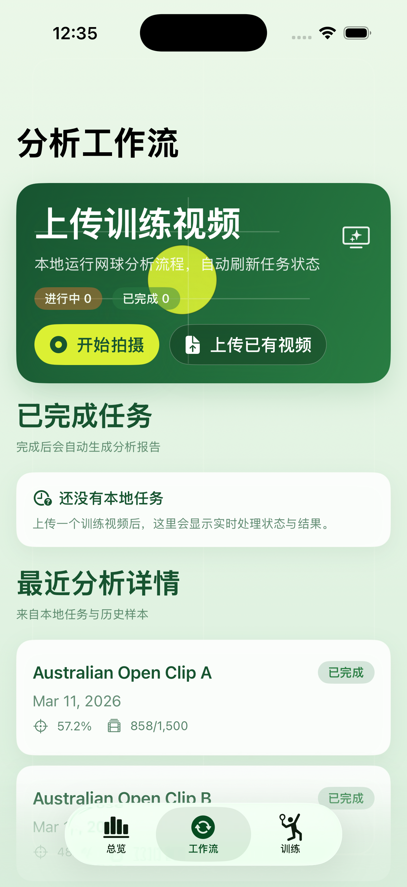
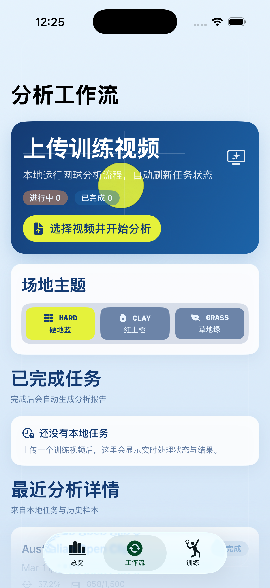
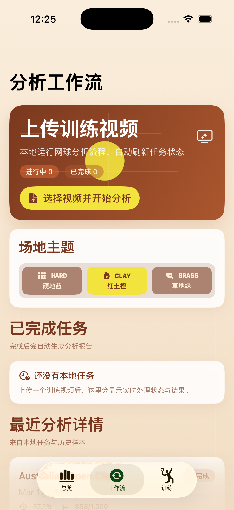
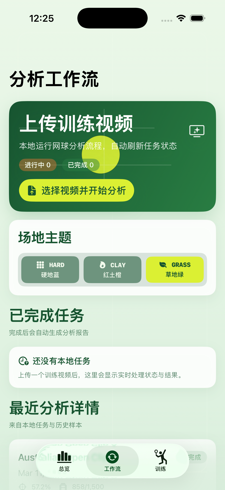

# Tennis AI

Video analysis for tennis practice. An iOS app runs ball tracking, pose estimation and shot recognition on device. An offline Python pipeline turns match video into structured rallies, shots, bounces and scores, and a small backend ingests the results.

<p align="center">
  
  
  
  
</p>

## Components

| Path | What it is |
|---|---|
| `Tennis AI/Tennis AI/` | SwiftUI app: video import, on-device inference, court calibration (homography), ByteTrack player tracking, playback export, session comparison, telemetry |
| `Tennis AI/ai/backend/` | FastAPI + Supabase ingestion, telemetry and smoke-test scripts |
| `Tennis AI/ai/phase1/` | Offline pipeline for court detection, ball tracking, shot detection, rally splitting, score timeline and a data contract for export |
| `docs/` | Architecture overview and integration playbook |

## On-device pipeline

1. **Ball.** A TrackNet-style heatmap network finds the ball in each frame, then bounces are projected onto the calibrated court plane.
2. **Players.** Person detection plus ByteTrack keeps a stable ID for each player.
3. **Pose.** MoveNet SinglePose Lightning produces 17 keypoints per frame.
4. **Shots.** A sequence model over the pose keypoints classifies forehand, backhand and serve. When that model isn't bundled, the app falls back to trajectory heuristics.

## Models

To keep this repository clean of third-party licensing issues, only **MoveNet** (Apache-2.0, from TensorFlow Hub) ships as a Core ML package. Convert the others locally:

```bash
python "Tennis AI/ai/convert_movenet.py"            # MoveNet → MoveNetSinglePoseLightning.mlpackage (already included)
python "Tennis AI/ai/convert_tracknet.py"           # needs GridTrackNet weights from its upstream repo
python "Tennis AI/ai/convert_shot_recognition.py" --source-model /path/to/tennis_rnn.h5
```

Check each upstream project's license before redistributing the converted models. The offline player tracker expects a YOLO checkpoint in `Tennis AI/ai/phase1/player_tracking/models/` (Ultralytics weights are AGPL-3.0).

## Build

```bash
xcodebuild -project "Tennis AI/Tennis AI.xcodeproj" \
  -scheme "Tennis AI" \
  -destination "generic/platform=iOS Simulator" \
  build
```

## CI smoke test

The `ci` workflow can be triggered manually to check the minimal backend path. It reads `SMOKE_BASE_URL`, `SMOKE_ACTOR_KEY` and, optionally, `SMOKE_VIDEO_URL` from repository secrets; values entered manually override them. Without a video URL it runs `--skip-analysis-upload` and only checks health and telemetry. The run uploads a `smoke-summary` artifact.

## Responsibilities

- **iOS** (`ios.ondevice.v1`) handles on-device inference and syncs session summaries.
- **Python phase 1** produces high-fidelity structured analysis (rallies, shots, bounces, score).
- **Backend** handles ingestion, storage, monitoring and observability.

## Acknowledgements

MoveNet (Google, Apache-2.0) · GridTrackNet (V. Korpelshoek) · tennis_shot_recognition (A. Keller) · ByteTrack (Zhang et al.)
