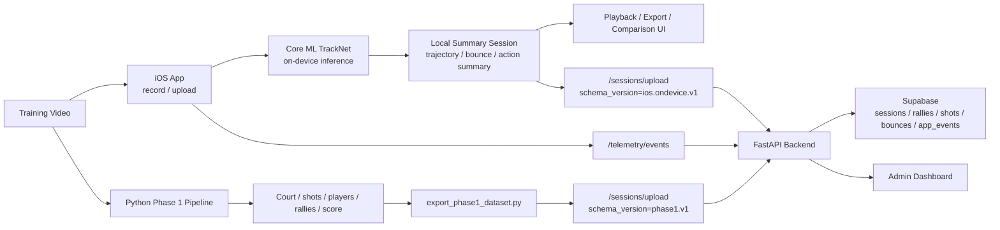

# Tennis AI Architecture

## Overview

The project runs as two analytics lanes that meet at the backend:

- `iOS local analysis lane`: fast, user-facing, summary-first
- `Python Phase 1 lane`: slower, offline, full-detail analytics
- `Backend + Supabase lane`: ingestion, telemetry, and ops visibility

## Data flow

## Source of truth

| Capability | Source of truth |
| --- | --- |
| Local playback and export | iOS local session |
| In-app comparison report | iOS local session |
| Telemetry and ops metrics | FastAPI + Supabase |
| Full rally / shot / bounce detail | Python Phase 1 exports |
| Score timeline and structured match state | Python Phase 1 exports |

## Contract rules

- `ios.ondevice.v1`
  - producer: iOS app
  - purpose: summary sync only
  - child arrays may be empty
  - should never be presented as full rally analytics
- `phase1.v1`
  - producer: Python Phase 1 exporter
  - purpose: full-detail analytics sync
  - owns normalized child rows

## Repo layout expectations

- Keep app code under `Tennis AI/`
- Keep backend code under `ai/backend/`
- Keep research and offline pipelines under `ai/phase1/`
- Keep generated outputs, local videos, screenshots, weights, and virtualenvs out of version control unless explicitly promoted
