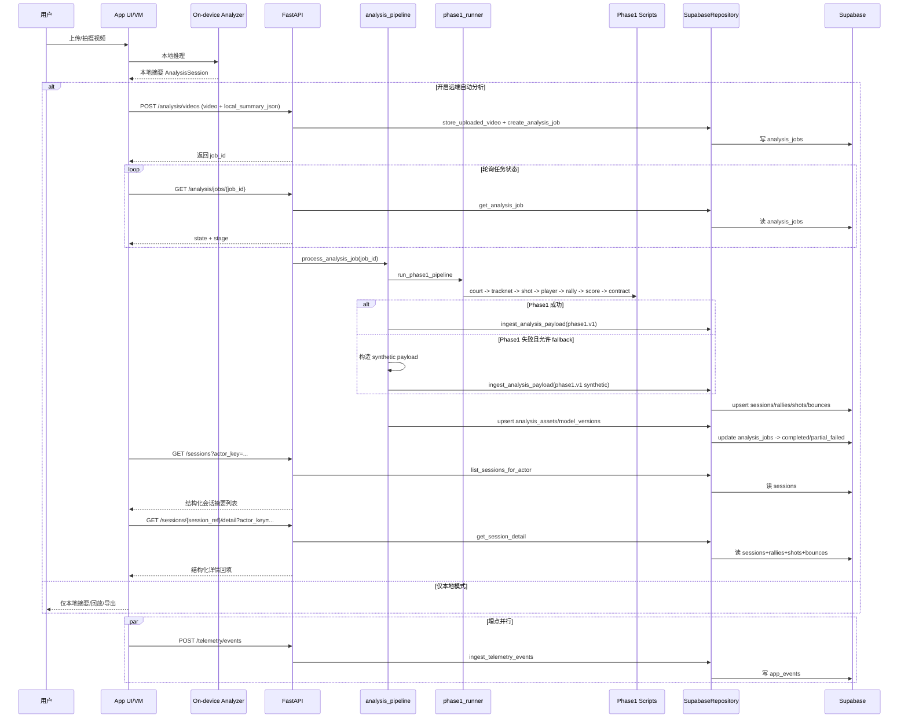

# Tennis AI 架构总览（研发向）

## 1. 系统目标与分层

Tennis AI 当前是双轨分析架构：

- `iOS 本地分析轨`：用户可见、响应快，产出本地摘要（轨迹/弹跳/动作）
- `Phase1 结构化分析轨`：服务端或离线执行，产出 rally/shot/bounce/score 全量结构化数据
- `Backend + Supabase`：任务编排、落库查询、埋点统计、运营看板

## 2. 模块依赖图（静态）

```mermaid
flowchart LR
  subgraph App["App (`Tennis AI/Tennis AI/`)"]
    UI["`ContentView.swift` + `WorkflowView.swift`"]
    VM["`TennisAIViewModel`（调用层）"]
    Analyzer["`OnDeviceVideoAnalyzer.swift`"]
    ModelLoader["`ModelRuntime.swift`"]
    Exporter["`VideoExportRenderer.swift`"]
    RemoteSvc["`RemoteAnalysisService.swift`"]
    LegacySync["`BackendSync.swift`"]
    Telemetry["`AppTelemetry.swift`"]
    Domain["`Models.swift`"]
  end

  subgraph Backend["FastAPI (`ai/backend/app/`)"]
    API["`main.py`"]
    Pipeline["`analysis_pipeline.py`"]
    Runner["`phase1_runner.py`"]
    Repo["`repository.py`"]
    Schemas["`models.py`"]
    Worker["`worker.py`"]
  end

  subgraph Phase1["Phase1 (`ai/phase1/`)"]
    Court["court detection"]
    Track["tracknet inference"]
    Shot["shot detection"]
    Player["player association"]
    Rally["rally segmentation"]
    Score["score timeline"]
    Contract["data contract export"]
  end

  subgraph DB["Supabase / PostgreSQL"]
    Sessions["sessions"]
    Rallies["rallies"]
    Shots["shots"]
    Bounces["bounces"]
    Jobs["analysis_jobs"]
    Assets["analysis_assets"]
    Events["app_events"]
    Overrides["session_overrides"]
    ModelVersions["model_versions"]
  end

  UI --> VM
  VM --> Analyzer
  Analyzer --> ModelLoader
  VM --> Exporter
  VM --> RemoteSvc
  VM --> LegacySync
  VM --> Telemetry
  VM --> Domain

  RemoteSvc --> API
  LegacySync --> API
  Telemetry --> API

  API --> Schemas
  API --> Repo
  API --> Pipeline
  Worker --> Pipeline
  Pipeline --> Runner
  Pipeline --> Repo

  Runner --> Court
  Runner --> Track
  Runner --> Shot
  Runner --> Player
  Runner --> Rally
  Runner --> Score
  Runner --> Contract

  Repo --> Sessions
  Repo --> Rallies
  Repo --> Shots
  Repo --> Bounces
  Repo --> Jobs
  Repo --> Assets
  Repo --> Events
  Repo --> Overrides
  Repo --> ModelVersions
```

## 3. 主调用链（动态）



## 4. 核心契约（研发必须遵守）

- 接口层：
  - 新链路：`/analysis/videos`、`/analysis/jobs`、`/sessions`、`/sessions/{ref}/detail`
  - 兼容链路：`/sessions/upload`
  - 埋点链路：`/telemetry/events`
- 状态机：
  - `analysis_jobs.state`：`queued|uploading|analyzing|partial_failed|completed|failed`
  - `analysis_jobs.stage` 与 App 文案保持可映射
- 数据契约：
  - `phase1.v1`：结构化真值
  - `ios.ondevice.v1`：摘要同步（子表可空）
  - `sessions` upsert 唯一键：`(actor_key, external_session_id)` 或 `(user_id, external_session_id)`
- 失败降级：
  - `player_tracking` 允许降级
  - Phase1 失败可 fallback synthetic（若配置允许），应标记 `partial_failed`

## 5. Source of Truth

| 能力 | 真值来源 |
| --- | --- |
| 本地回放/导出/训练建议 | iOS 本地会话 |
| 结构化回合/击球/弹跳/比分 | Python Phase1 导出 |
| 运营埋点与后台看板 | FastAPI + Supabase |
